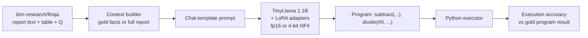

# FinQA: Numerical Reasoning over Financial Reports with LoRA & QLoRA

Fine-tuning **TinyLlama-1.1B-Chat** to answer numerical questions about company financial reports (the **FinQA** benchmark, `ibm-research/finqa`). The project compares **LoRA** and **QLoRA (4-bit)** under identical settings on a single free-tier Colab **T4** GPU.

Instead of asking a 1.1B model to do arithmetic, the model is trained to write a short **reasoning program** that Python executes:

```text
Question: what was the percentage change in net revenue from 2018 to 2019?
Evidence: net revenue was $ 5829 million in 2019 compared to $ 5735 million in 2018 .

Model output ->  Program: subtract(5829, 5735), divide(#0, 5735)
                 Answer: 0.01639
Executor     ->  0.01639  (≈ 1.6 %)
```

## Highlights

- **Program supervision + a Python executor.** The model writes the program and Python computes the result, so small models are not limited by their arithmetic. The executor follows the official FinQA rules and reproduces the dataset's gold results on **8,279 / 8,281** examples. The 2 misses are known label errors.
- **Correct causal-LM fine-tuning.** The loss covers only the answer tokens, the model is trained to emit EOS (so generation stops), and answers are never truncated.
- **Real metric.** The main metric is **execution accuracy** on the test set, reported for the base model and the fine-tuned model. Validation loss alone doesn't tell you whether answers are right.
- **Fair LoRA vs QLoRA comparison.** One flag (`USE_4BIT`) switches the method; everything else stays the same.
- **Research logging.** Each run records loss, gradient norm, LoRA adapter norm, GPU memory and training time, plus a predictions CSV and an error analysis broken down by reasoning depth.
- **Tested.** CPU-only unit tests cover the executor, scoring and data schema, and a test fails if the notebook drifts from the source module.

## How it works



| Component | Choice | Why |
|---|---|---|
| Base model | `TinyLlama/TinyLlama-1.1B-Chat-v1.0` | Fits QLoRA *and* fp16 LoRA on a 16 GB T4 |
| Target | `Program: <FinQA program>` + `Answer: <value>` | Model reasons, Python calculates |
| Loss | Answer tokens only (prompt labels = `-100`) + EOS | Learns the task, not the report text; stops generating |
| Padding | `<unk>` as pad token | Keeps EOS a real training target |
| LoRA | r=16, α=32, dropout 0.05, all 7 projection layers | ~12.6M trainable params (≈1.1%) |
| QLoRA | NF4, double quantization, fp16 compute | T4 has no bf16 |
| Optimizer | lr 2e-4, cosine, 30 warm-up steps, effective batch 16, 2 epochs | Standard QLoRA recipe |
| Checkpointing | Best `eval_loss` checkpoint restored at the end | Avoids keeping an overfit final step |

### Context modes

FinQA reports are long: the full table plus text averages about **4,100 characters (1,000+ tokens)**, while the gold supporting facts (`gold_inds`) average about **430 characters**.

| `CONTEXT_MODE` | Input | Interpretation |
|---|---|---|
| `"gold"` (default) | Gold supporting facts only | **Oracle-retriever** setting: measures reasoning, given perfect evidence retrieval |
| `"full"` | Table + all report text, trimmed to `MAX_CONTEXT_TOKENS` | Realistic end-to-end setting, which is harder |

When you report results, say which mode you used. The two settings are not directly comparable.

### Metrics

| Metric | Meaning |
|---|---|
| **Program accuracy** (main) | The generated program executes and matches the gold result (rel. tol. 1e-3) |
| Answer accuracy | The number written after `Answer:` matches, i.e. the model did the arithmetic itself |
| Valid-program rate | Share of outputs whose program could be executed at all |

The ground truth is the **gold program's executed result**, the same value FinQA's official metric uses. The dataset's `answer` field is noisy: in the very first training example, `answer` is `380` but the gold program evaluates to `3.8`.

## Results

> Results are produced by running the notebook on a GPU. Run both configurations, then paste the table produced by `python tools/compare_runs.py`.

| Run | Method | Context | Base program acc | Fine-tuned program acc | Fine-tuned answer acc | Peak GPU mem (GB) | Train time (min) |
|---|---|---|---|---|---|---|---|
| `qlora_gold` | QLoRA (4-bit) | gold | _pending_ | _pending_ | _pending_ | _pending_ | _pending_ |
| `lora_gold` | LoRA (fp16) | gold | _pending_ | _pending_ | _pending_ | _pending_ | _pending_ |

Each run writes the following to `outputs/<run>/`:

```text
results.json              summary metrics (used by tools/compare_runs.py)
training_signals.csv      loss, grad norm, adapter norm, GPU memory per logging step
training_curves.png       loss / grad-norm / adapter-norm plots
predictions_base.csv      base model generations + per-example scores
predictions_finetuned.csv fine-tuned generations + per-example scores
final_adapter/            LoRA adapter + tokenizer
```

## Quick start

### Train on Google Colab (GPU required)

1. Open `FinQA_LoRA_QLoRA.ipynb` in Colab and choose **Runtime → Change runtime type → T4 GPU**.
2. In the configuration cell, set `USE_4BIT = True` (QLoRA) or `False` (LoRA), and optionally `CONTEXT_MODE` and `EVAL_SAMPLES`.
3. **Run all.** With `SAVE_TO_DRIVE = True`, outputs go to `MyDrive/FinQA_Research/outputs/<run>/`, so they survive the session ending.

The notebook is self-contained: it embeds `finqa_utils.py`, so you don't need to upload any other files.

### Inference with a trained adapter

```bash
pip install -r requirements.txt
python inference.py --adapter outputs/qlora_gold/final_adapter \
    --question "what was the percentage change in net revenue from 2018 to 2019?" \
    --context "net revenue was $ 5829 million in 2019 compared to $ 5735 million in 2018 ."
```

Pass `--table table.json` (a list of rows) to enable `table_sum`, `table_average` and the other table operations. Add `--load-in-4bit` on a GPU. Without a GPU, inference falls back to CPU (slow, but it works for a 1.1B model).

### Tests (CPU only, standard library)

```bash
python -m unittest discover tests -v

# optional: check the executor against every gold program in FinQA
FINQA_DATA_DIR=/path/to/FinQA/dataset python -m unittest discover tests -v
```

## Project structure

```text
FinQA_LoRA_QLoRA.ipynb      main notebook (generated by tools/build_notebook.py)
finqa_utils.py              data loading, program executor, prompts, scoring
inference.py                command-line inference with a saved adapter
requirements.txt            pinned versions (verified on Colab)
tests/test_finqa_utils.py   CPU unit tests + notebook-sync check
tools/build_notebook.py     regenerates the notebook from finqa_utils.py + requirements.txt
tools/compare_runs.py       collects outputs/*/results.json into a Markdown table
Lora_experimentation.ipynb  first-iteration experiments (superseded, kept for reference)
Qlora_Experimentation.ipynb first-iteration experiments (superseded, kept for reference)
```

After editing `finqa_utils.py` or `requirements.txt`, run `python tools/build_notebook.py`. The test suite fails if you forget.

### Dataset note

`ibm-research/finqa` on the Hugging Face Hub is a **loading script**, and `datasets >= 4.0` no longer executes loading scripts. `load_finqa()` tries the Hub first. If that fails, it downloads the same source archive the script uses ([czyssrs/FinQA](https://github.com/czyssrs/FinQA)) and builds identical columns: `id, pre_text, post_text, table, question, answer, final_result, program_re, gold_inds`. Splits: **6,251 train / 883 validation / 1,147 test**.

## What changed from the first iteration

The two `*_experimentation.ipynb` notebooks were the first attempt. Reviewing them turned up issues that made their results hard to interpret. Each issue is fixed in the current pipeline:

| Issue in v1 | Effect | Fix |
|---|---|---|
| Context → Question → Answer cut at 512 tokens | Most examples lost their question and answer | Short gold context or a trimmed context; examples are never truncated, over-length ones are dropped |
| Loss on every token | Validation loss mostly measured how well the model predicted report text | Prompt tokens masked with `-100` |
| `pad_token = eos_token` + LM collator | EOS was always masked, so the model never learned to stop | `<unk>` pad and an explicit EOS on every target |
| Validation loss as the only metric | No signal on whether answers were right | Execution accuracy, base vs fine-tuned |
| Trained on the noisy `answer` field | Wrong targets for some examples | Gold program + executed result |
| LoRA: gradient checkpointing on a frozen fp16 base | Adapters could receive no gradient | `enable_input_require_grads()` + non-reentrant checkpointing |
| QLoRA: undefined `results` variable; second base model loaded for comparison | Crash; extra GPU memory | Fixed; base model evaluated via `disable_adapter()` |
| LoRA r=8 on `q_proj`/`v_proj` only (0.1% params) | Limited capacity | r=16 on all projection layers |
| Two near-duplicate notebooks, unpinned installs | Configurations drifted; not reproducible | One notebook + `USE_4BIT` flag; pinned `requirements.txt` |

## Limitations

- **Oracle evidence by default.** `gold` mode assumes the supporting facts are already retrieved. `full` mode, or a trained retriever, is the realistic setting.
- **Small model.** At 1.1B parameters, multi-step programs and table operations remain hard. Expect accuracy to fall with the number of reasoning steps (the notebook breaks this down).
- **Subset evaluation.** The default `EVAL_SAMPLES = 300` saves Colab time. Use `None` for the full 1,147-question test set before reporting final numbers.
- **Single seed.** Differences of a few points between LoRA and QLoRA may be noise. Run several seeds before drawing conclusions.

## Roadmap

- [ ] Run the QLoRA and LoRA baselines and publish the results table
- [ ] `full` context mode with a lightweight retriever (BM25 or embeddings over sentences and table rows)
- [ ] Stronger small base models (Qwen2.5-1.5B-Instruct, Llama-3.2-1B-Instruct)
- [ ] Self-consistency: sample several programs and take a majority vote over their executed results
- [ ] Multiple seeds with confidence intervals for the LoRA vs QLoRA comparison
- [ ] Publish the adapter on the Hugging Face Hub

## References

- Chen et al., **FinQA: A Dataset of Numerical Reasoning over Financial Data**, EMNLP 2021. [paper](https://arxiv.org/abs/2109.00122) · [code/data](https://github.com/czyssrs/FinQA)
- Hu et al., **LoRA: Low-Rank Adaptation of Large Language Models**, 2021. [arXiv:2106.09685](https://arxiv.org/abs/2106.09685)
- Dettmers et al., **QLoRA: Efficient Finetuning of Quantized LLMs**, 2023. [arXiv:2305.14314](https://arxiv.org/abs/2305.14314)
- Zhang et al., **TinyLlama: An Open-Source Small Language Model**, 2024. [arXiv:2401.02385](https://arxiv.org/abs/2401.02385)

```bibtex
@inproceedings{chen2021finqa,
  title     = {FinQA: A Dataset of Numerical Reasoning over Financial Data},
  author    = {Chen, Zhiyu and Chen, Wenhu and Smiley, Charese and Shah, Sameena and Borova, Iana and Langdon, Dylan and Moussa, Reema and Beane, Matt and Huang, Ting-Hao and Routledge, Bryan R and others},
  booktitle = {Proceedings of EMNLP 2021},
  pages     = {3697--3711},
  year      = {2021}
}
```
